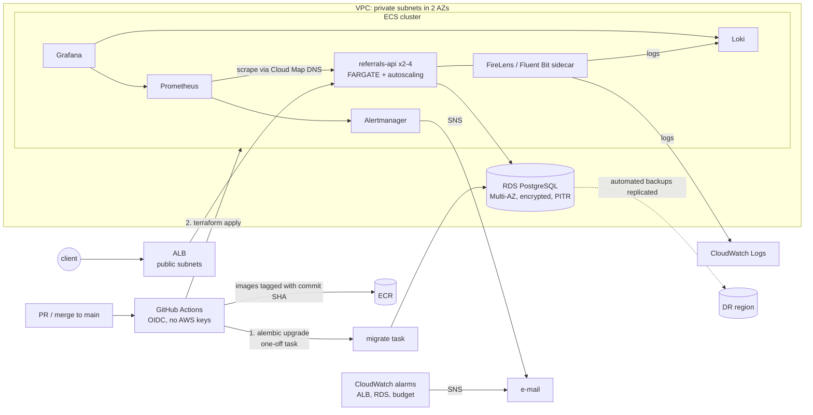

# clariness-ecs-rds-platform

[](https://github.com/Arun-Singh-Chauhan-09/clariness-ecs-rds-platform/actions/workflows/ci.yml)

A production-style AWS platform for a **clinical-trial referral API**: ECS
Fargate, RDS PostgreSQL, Terraform modules, GitHub Actions with OIDC,
Prometheus/Loki/Grafana/Alertmanager, and five failure drills with runbooks.

> Personal portfolio project, built to match the DevOps Engineer role at
> Clariness (AWS ECS/RDS, Terraform, CI/CD, backup/DR, safe migrations).
> **Not affiliated with or endorsed by Clariness.** All data is synthetic, and
> the API rejects anything that looks like personal data.

---

## What it runs

Patient-recruitment work comes down to moving candidates through a funnel. The
API models that: a **study** is published, a pre-screened candidate (an opaque
pseudonymous token, never a name or e-mail) is **referred** to a study site,
and the referral moves `prescreened -> referred -> contacted -> enrolled | declined`.
`GET /studies/{id}/funnel` returns the recruitment funnel.



Full write-up with deployment, alerting and recovery flows: **[docs/architecture.md](docs/architecture.md)**.

## How this maps to the role

| The job asks for | Where it is |
|---|---|
| AWS production infrastructure, **ECS, RDS** and supporting services | `terraform/modules/ecs-service`, `rds-postgres`, `alb`, `network` |
| **Terraform**: modules, state management, changes through version control and review | 5 reusable modules; S3 remote state with native lock file; `terraform plan` posted on every PR; daily drift detection |
| **CI/CD**, containerised apps, production deployments | `.github/workflows/`: test -> scan -> build -> migrate -> deploy -> smoke test; ECS circuit breaker with automatic rollback |
| Monitoring, troubleshooting incidents | Prometheus/Loki/Grafana/Alertmanager plus CloudWatch alarms; `docs/runbooks/incident-response.md` (one section per alert) |
| **Backup and disaster recovery** | PITR (7 days), cross-region backup replication, a scripted restore drill that measures RTO/RPO |
| **High availability** | 2 AZs, Multi-AZ RDS, 2+ tasks behind the ALB, failover drill |
| **Safe database migrations** | expand/contract, a CI guard that blocks unsafe migrations, lock timeouts, migrate-before-deploy |
| Cloud cost efficiency | Fargate Spot for observability, one NAT gateway, S3 gateway endpoint, ECR lifecycle, AWS Budget alert |
| Explaining technical trade-offs | `docs/adr/`: ECS vs EKS, self-hosted vs managed observability, GitOps without ArgoCD |

---

## Run it locally (no AWS account needed)

Requirements: Docker with Compose v2, Python 3.12, make.

```bash
make up        # API, Postgres, Fluent Bit, Loki, Prometheus, Alertmanager, Grafana
make seed      # synthetic studies + referrals
make load      # 2 minutes of traffic
```

| | |
|---|---|
| API docs | http://localhost:8000/docs |
| Grafana (admin/admin) | http://localhost:3000, dashboard **Referrals / Referrals API** |
| Prometheus | http://localhost:9090/alerts |
| Alertmanager | http://localhost:9093 |
| Alert notifications | `make logs` (the `alert-sink` container prints them) |

Tests run against a real Postgres: `make test`. Config checks: `make promtool`, `make check-migrations`.

---

## Deploy to AWS

Cost while running, with the defaults in `terraform.tfvars.example` (single
NAT, no Multi-AZ): roughly **$3-5 per day** (NAT gateway ~$1.10, ALB ~$0.60,
RDS t4g.micro ~$0.40, Fargate tasks ~$1-2). Multi-AZ adds ~$0.40/day.
**Run `terraform destroy` when you're done.**

### 1. Bootstrap (once, local state)
```bash
cd terraform/bootstrap
cp terraform.tfvars.example terraform.tfvars   # bucket name, your GitHub repo
terraform init && terraform apply
```
Creates the state bucket and two OIDC roles: `plan` for PRs (read-only) and
`deploy` for jobs in the GitHub environment `staging`.

### 2. GitHub settings
- Environment **`staging`** (add yourself as required reviewer if you want a manual gate)
- Secrets: `AWS_PLAN_ROLE_ARN`, `AWS_DEPLOY_ROLE_ARN` (bootstrap outputs)
- Variables: `AWS_REGION`, `TF_STATE_BUCKET`, `ALERT_EMAIL`

### 3. First deploy (the pipeline needs existing infrastructure to run migrations)
```bash
cd terraform/envs/staging
cp backend.hcl.example backend.hcl && cp terraform.tfvars.example terraform.tfvars
terraform init -backend-config=backend.hcl
terraform apply -target=aws_ecr_repository.this          # registries first
../../../scripts/build-push.sh v0                        # all six images, tag v0
terraform apply -var image_tag=v0
../../../scripts/run-migration.sh "$(terraform output -raw ecr_registry)/referrals-api:v0"
../../../scripts/smoke-test.sh "$(terraform output -raw api_base_url)"
```
After that, every merge to `main` deploys through `deploy.yml`.

### Operating it
| Task | Command |
|---|---|
| Grafana / Prometheus / Alertmanager (private, via ECS Exec) | `scripts/port-forward.sh grafana` |
| Run a command next to the database | `scripts/run-oneoff.sh python -m referrals.verify_restore` |
| Migrations by hand | `scripts/run-migration.sh <image-uri>` |
| What version is live | `scripts/current-image-tag.sh` |

---

## Delivery pipeline

```
PR ──► ci.yml           ruff · pytest on real Postgres · migration guard · Trivy image scan
   │                    promtool config + alert unit tests · amtool
   │                    terraform fmt / validate / tflint · Checkov
   └─► terraform-plan   plan of staging posted as a PR comment

merge ─► deploy.yml     build 6 images (tag = commit SHA, immutable ECR tags)
                        1. alembic upgrade head as a one-off ECS task   (stops here on failure)
                        2. terraform apply -var image_tag=<sha>         (waits for steady state;
                                                                         circuit breaker rollback = red build)
                        3. smoke test: version, readiness, write + read

daily ─► drift.yml      terraform plan -detailed-exitcode -> GitHub issue on drift
```
Why there is no ArgoCD: [ADR 0003](docs/adr/0003-gitops-style-delivery-without-argocd.md).

## Observability

| Signal | Source | Alert |
|---|---|---|
| Request rate, 5xx ratio, p95 latency per route | `/metrics` (route templates, bounded cardinality) | `ApiHigh5xxRate`, `ApiHighLatencyP95` |
| DB reachability per task | scrape-time `SELECT 1` on a separate connection (`db_up`) | `ApiDatabaseUnreachable` |
| Connection-pool usage | SQLAlchemy pool collector | `DbPoolSaturated` |
| Task liveness | Cloud Map DNS service discovery | `ApiTargetDown`, `ApiNoTargets` |
| Business: referrals created, status transitions | app counters | dashboard |
| Logs | FireLens -> Loki **and** CloudWatch | `LokiDown` |
| ALB 5xx/unhealthy/latency, RDS CPU/storage/connections/memory, spend | CloudWatch | alarms -> SNS |

Every alert links to its section in `docs/runbooks/incident-response.md`.
Alert rules have unit tests (`observability/prometheus/tests/alerts_test.yml`).

## Drills: break it on purpose

| # | What breaks | What should happen | Write-up |
|---|---|---|---|
| 01 | A column rename while the old release is still running | CI guard blocks it; if forced: 5xx alert within minutes | [01](docs/drills/01-unsafe-migration.md) |
| 02 | Rows deleted by accident | PITR to a new instance, verified in-VPC, RTO/RPO measured | [02](docs/drills/02-point-in-time-restore.md) |
| 03 | Primary DB fails | Multi-AZ failover; app reconnects on its own; error window measured | [03](docs/drills/03-multi-az-failover.md) |
| 04 | Release with broken DB config | New tasks exit at start-up; circuit breaker rolls back; zero failed requests | [04](docs/drills/04-bad-release.md) |
| 05 | Pool exhaustion under load | Pool saturation alert, then latency alert; capacity rule documented | [05](docs/drills/05-connection-pool-exhaustion.md) |

Results of scripted drills land in `docs/drills/results/`.

### The story behind drill 01
Renaming a column looks harmless in review and passes every test, because tests
run one version of the code. In production, ECS replaces tasks gradually: for a
few minutes the old release and the new schema coexist, and if the deployment
fails, the circuit breaker brings the old release back on the new schema
permanently. The old code still writes `title`, so writes start failing.

The fix has three parts:
1. **Expand/contract**: `0002` adds `display_name` and backfills it in batches. The app writes both columns.
   Dropping `title` waits in `migrations/pending/` until no running task reads it.
2. **Make it hard to repeat**: `scripts/check_migrations.py` parses each
   migration's `upgrade()` and fails CI on renames, drops, type changes,
   `SET NOT NULL` and non-concurrent indexes. The only way past is a
   `# contract-approved: <reason>` comment on that line, which a reviewer sees.
3. **Fail fast if it happens anyway**: `lock_timeout`/`statement_timeout` on
   migrations, migrate-before-deploy, and an alert on the 5xx ratio.

### A real one: the migration that "succeeded" but changed nothing
Found on the first local run, not staged. `alembic upgrade head` exited 0 and
compose started the API, but `/readyz` returned 503. The API's start-up check
had passed (`SELECT 1`), so the database was reachable, yet the
`alembic_version` table did not exist.

- **Cause:** `migrations/env.py` ran `SET lock_timeout` before handing the
  connection to Alembic. SQLAlchemy 2.x opens a transaction on that first
  statement, so Alembic joined it instead of owning it, and the whole migration
  was rolled back when the connection closed. Exit code 0, no schema.
- **Fix:** commit after the `SET`s (session settings survive the commit).
- **Why it was caught:** readiness checks the *schema revision*, not just the
  connection, and the test suite asserts `schema_revision == "0002"`.
  A plain `SELECT 1` health check would have reported this broken release as healthy.
- **Lesson:** a migration step's exit code is not proof. Verify the resulting
  state, which the post-deploy smoke test now does through `/readyz`.

### Another real one: the image scan blocked the first push
The first CI run on GitHub failed at the Trivy scan: 4 fixable HIGH CVEs. Three
were in Starlette 0.41.3 (pulled in by FastAPI 0.115: Range-header DoS, SSRF via
UNC paths, form-size limits ignored) and one in Debian's zlib in the base image.
Fix: upgraded FastAPI/Starlette/Pydantic (a Starlette major version, so the full
test suite was re-run against Postgres before pinning) and added
`apt-get upgrade` to the runtime image for Debian security fixes. The gate did
its job: the vulnerable image never reached a registry.

---

## Repository layout

```
app/                      FastAPI service, Alembic migrations, tests, Dockerfile
observability/            Prometheus (config + rules + rule tests), Alertmanager, Loki, Grafana, Fluent Bit
terraform/bootstrap/      state bucket + GitHub OIDC roles
terraform/modules/        network · alb · rds-postgres · ecs-service · observability
terraform/envs/staging/   the environment, composed from the modules
.github/workflows/        ci · terraform-plan · deploy · drift
scripts/                  migration runner, smoke test, DR + failover drills, port-forward, load/seed
drills/                   the deliberately unsafe migration used in drill 01
docs/architecture.md      architecture: request, deploy, alerting and recovery flows
docs/adr/                 architecture decisions and trade-offs
docs/runbooks/            migrations, DR restore, alert response
docs/drills/              drill plans and results
```

## Project status

| | |
|---|---|
| Migration guard and its tests | run and passing |
| App, migrations, tests, compose stack | running locally; 10 app tests (real Postgres) + 17 guard tests pass |
| Terraform | `fmt` clean, `validate` passes for all 7 roots/modules; not yet applied |
| Drills | plans written; "Observed" sections are filled in only after a real run |

## Known limitations / next steps
- HTTPS needs a domain and ACM certificate (`certificate_arn`); the demo serves HTTP.
- Prometheus storage is ephemeral; production would use EFS or remote-write to AMP.
- No RDS Proxy yet. It would be needed past ~15 API tasks (see drill 05).
- ECR images are not replicated to the DR region yet.
