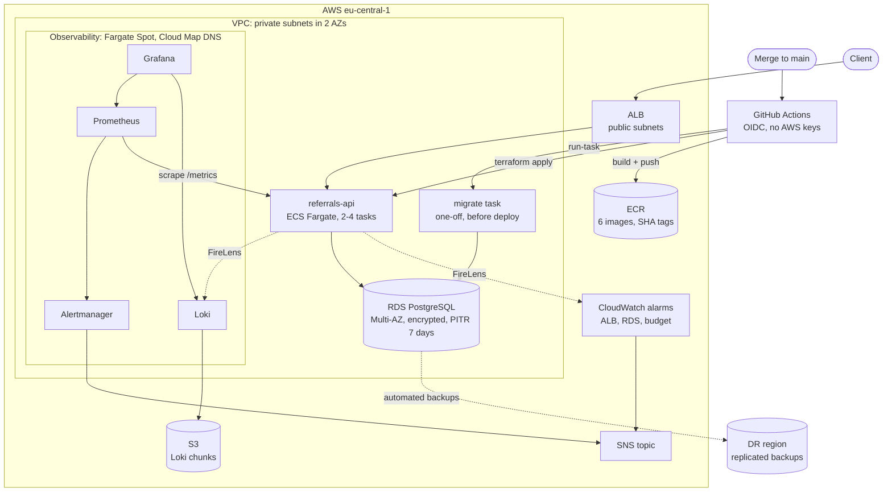
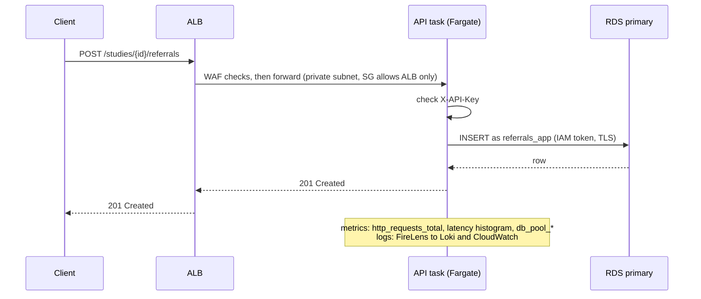
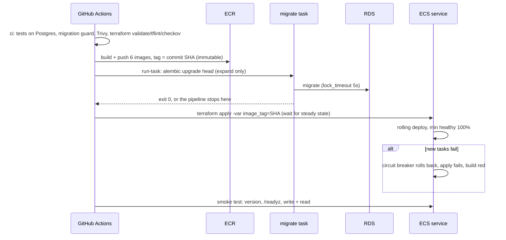

# Architecture

How `clariness-ecs-rds-platform` is put together in AWS, how a change reaches
production, and how failures are detected and recovered. The reasons behind
the main choices are in [`docs/adr/`](adr/).

## 1. Overview

| Layer | What | Terraform |
|---|---|---|
| Network | VPC, 2 public + 2 private subnets, NAT (single or per AZ), S3 gateway endpoint, REJECT flow logs | `modules/network` |
| Edge | ALB, HTTP (HTTPS when a certificate is set), target group on `/healthz`, 5xx/latency/unhealthy alarms | `modules/alb` |
| Compute | ECS Fargate services and task definitions, circuit breaker, autoscaling, ECS Exec, Cloud Map | `modules/ecs-service` (reused 6x) |
| Data | RDS PostgreSQL, KMS, managed master secret, PITR, cross-region backup copy, alarms | `modules/rds-postgres` |
| Observability | Prometheus, Alertmanager, Loki (S3), Grafana, shared SG, admin secret | `modules/observability` |
| Foundations | S3 state bucket with lock file, GitHub OIDC plan/deploy roles | `bootstrap/` |

## 2. A request

- AWS WAF filters requests at the ALB (managed rules + per-IP rate limit), and the ALB answers `/metrics` and `/docs` with 404.
- Every business endpoint requires an `X-API-Key`; the key's fingerprint is logged for audit.
- Tasks have no public IP. The API security group accepts traffic only from the ALB and from Prometheus.
- The API connects as `referrals_app` (read/write rows only) using a 15-minute IAM auth token: it has no database password. Only the migration task gets the master password, injected by ECS from the RDS-managed secret. See [security.md](security.md).
- `pool_pre_ping` discards connections killed by a Multi-AZ failover, so tasks recover without a restart.

## 3. A deployment (GitOps-style, no ArgoCD)

- Git is the desired state. A PR shows the `terraform plan` as a comment; a daily
  `terraform plan -detailed-exitcode` opens an issue on drift ([ADR 0003](adr/0003-gitops-style-delivery-without-argocd.md)).
- Migrations run before the new code and must work with the old release too
  (expand/contract). CI blocks unsafe ones ([runbook](runbooks/db-migrations.md)).
- Rollback = revert the commit; the pipeline redeploys the previous SHA.

## 4. Detection and alerting

Two independent paths reach the same SNS topic, so one failing does not blind the other:

| Path | Signals | Examples |
|---|---|---|
| Prometheus -> Alertmanager | application | `ApiHigh5xxRate`, `ApiHighLatencyP95`, `ApiDatabaseUnreachable`, `DbPoolSaturated`, `ApiTargetDown` |
| CloudWatch alarms | infrastructure | ALB 5xx / unhealthy targets / p95, RDS CPU / storage / connections / memory, monthly budget |

Every Prometheus alert links to its section in [`runbooks/incident-response.md`](runbooks/incident-response.md).
Alert rules have unit tests (`observability/prometheus/tests/alerts_test.yml`, run in CI).
The observability UIs are private: `scripts/port-forward.sh grafana` uses ECS Exec through SSM.

## 5. Data protection and recovery

| Failure | Protection | Recovery point / time | Proven by |
|---|---|---|---|
| Instance or AZ fails | Multi-AZ synchronous standby | RPO 0, failover ~1-2 min | drill 03 |
| Bad migration / accidental delete | automated backups + PITR (7 days) | any second in the window | drill 02 |
| Region lost | backups replicated to `dr_region` | same, restored in DR region | [runbook](runbooks/dr-restore.md) |
| Unsafe schema change | expand/contract + CI guard | prevented before merge | drill 01 (done) |
| Broken release | start-up DB check + circuit breaker | no failed requests (old tasks keep serving) | drill 04 (done locally) |

## 6. Local mode

`docker compose` runs the same app image and the same Prometheus, Alertmanager,
Loki, Grafana and Fluent Bit configs as ECS, plus Postgres and a webhook
`alert-sink` that prints notifications. Differences from AWS: static scrape
targets instead of Cloud Map, filesystem instead of S3 for Loki, the Docker
fluentd log driver instead of FireLens, and no circuit breaker (drill 04 shows
what that means).

## 7. Cost levers (staging)

Single NAT gateway, Fargate Spot for the observability services, S3 gateway
endpoint (keeps ECR/Loki traffic off NAT), ECR lifecycle (20 images), 14-day log
retention, RDS Multi-AZ as a variable, AWS Budget alert. Roughly $3-5/day while
running; `terraform destroy` afterwards.
